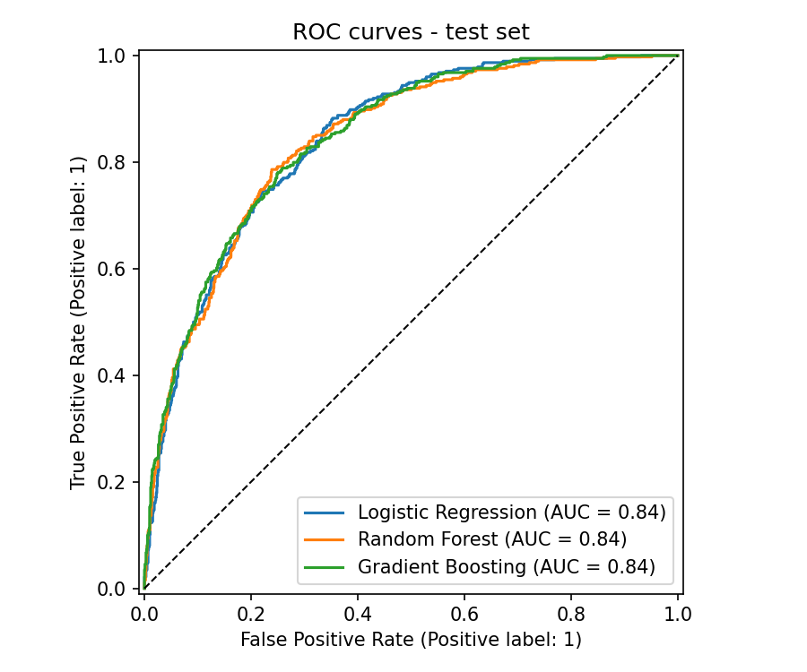
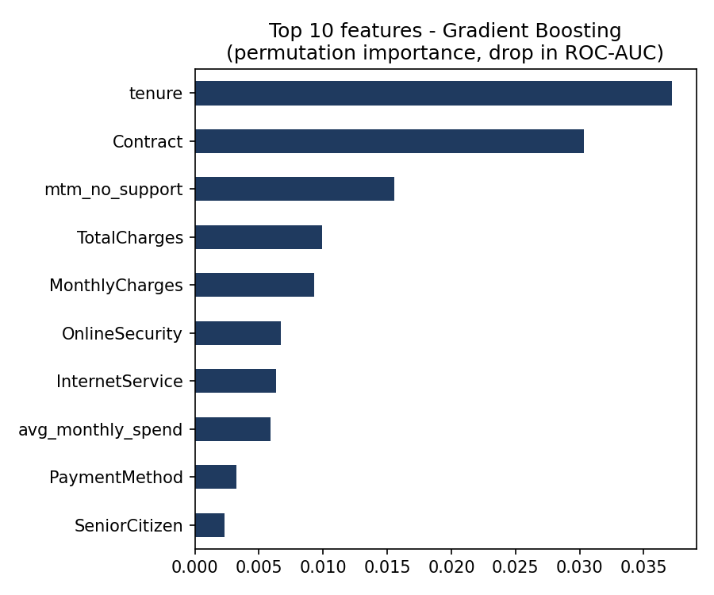

# Telecom Customer Churn Prediction

Predicting which telecom customers are likely to cancel their contract (churn), so that a retention team can contact the highest-risk customers first.

**Dataset:** [IBM Telco Customer Churn](https://github.com/IBM/telco-customer-churn-on-icp4d) (7,043 customers, 20 features, 26.5% churn rate).

## Approach

1. **Data cleaning.** Converted `TotalCharges` to numeric (blank values belong to brand-new customers).
2. **Feature engineering:**
   - `num_services`: number of add-on services the customer uses
   - `avg_monthly_spend`: lifetime spend divided by tenure
   - `tenure_group`: tenure buckets (0–12, 12–24, 24–48, 48–72 months)
   - `mtm_no_support`: month-to-month contract without tech support (a high-risk profile)
3. **Modeling.** Compared Logistic Regression, Random Forest and Gradient Boosting in scikit-learn pipelines (scaling + one-hot encoding), using stratified 5-fold cross-validation. Class imbalance was handled with class weights and a tuned decision threshold. The threshold was chosen on out-of-fold training predictions, never on the test set.
4. **Evaluation.** Used a held-out 20% test set with ROC-AUC, F1, precision/recall and **lift in the top 10%** of customers (the business metric for a retention campaign).
5. **Explainability.** Measured permutation feature importance on the test set.

## Results (held-out test set)

| Model | ROC-AUC | F1 (churn) | Lift @ top 10% |
|---|---|---|---|
| **Gradient Boosting** | **0.844** | 0.62 | **2.96×** |
| Logistic Regression | 0.842 | 0.63 | 2.80× |
| Random Forest | 0.841 | 0.64 | 2.88× |

- The best model catches **73% of churners** (recall), with 54% precision.
- Among the 10% of customers the model rates as riskiest, churners are **~3× more common** than in a random sample. A retention campaign aimed at them would reach about 3× as many at-risk customers for the same cost.
- The strongest churn drivers are **short tenure**, **month-to-month contracts** and **no tech support / online security**.




## Run it

```bash
pip install -r requirements.txt
python churn_prediction.py
```

The results tables and charts are saved to `results/`.
